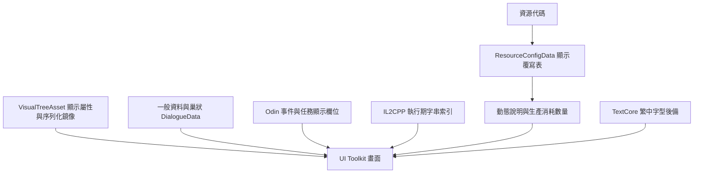

# 結構與漢化方法

## 文字如何進入畫面

主要文字容器為 `sharedassets1.assets`。UI 以 UI Toolkit 為主，不能只搜尋 TextMeshPro；執行期硬編碼字串另在 `global-metadata.dat`。`resources.assets` 與 `globalgamemanagers.assets` 同時載入以解析外部參照。

## 各層的處理

1. **UI Toolkit**：修改 `text`、`label`、`tooltip`、`title`、placeholder 等可見屬性，並處理 UXML attribute 與 serialized-data 鏡像。保護階層、引用、類別及查找名稱。
2. **一般與巢狀資料**：頂層欄位以外也需遞迴檢查。人口首次成長對話位於物件 `11218` 的 `_firstBirthDialogue.Title/Description/Options[].OptionText`；只翻頂層會漏掉。
3. **Odin**：依欄位及節點型別判定用途。NamedString 的 `Name` 不可全部翻譯；確認為 `Actions.Section` 顯示標題者才處理。保留 GUID、任務關聯、序列化參照、數值與非文字資料。字串編碼需同時支援 8/16 bit。
4. **IL2CPP v39**：保留 21,110 個字串索引的順序。附加新的 UTF-8 字串資料池，重寫對應 offsets 與資料區表頭；不要更動識別名稱資料區，也不要對整個檔案做任意字串取代。舊資料池中的英文可能是已停用內容，不能以 raw grep 算漏翻。
5. **字型**：保留 Barlow 主字型，新增 TextCore 動態繁中後備字型；本機使用 Noto Sans TC 400 實例，開啟 MultiAtlas。字型來源授權文字保存在 `notices/`，字型二進位未包含。

## 0.2.1 動態資源修正

`ResourceManager.GetResourceDisplayName` 呼叫 `ResourceConfigData.GetResourceDisplayName`，先找 `_resourceNameOverrides`，沒有值才回退到 enum 的英文 `ToString()`。所以模板雖然已中文化，仍會插回 `Waste`、`Water`、`Raw Materials`、`Metal`。

在物件 `11220` 的 Odin dictionary 補齊 **18/18** 顯示值（包含 None），只改顯示覆寫，資源列舉數值與儲存名稱均保留。`ProductionFacilityData.GetDescription`、`StorageData.GetDescription`、`PriceItemView.CreateModuleShopTooltipItem` 等會取用同一顯示入口。

## Construction 共享名稱

字串索引 `4440` 的 `Construction` 同時作為提示標題與 `ResearchNode.BuildConstruction` 的 `Q` 查找名稱。此版將它改成「建造」，同步修改物件 `11798` 的兩個 UXML 鏡像名稱。已檢查沒有同名 USS selector，並實測研究提示與研究按鈕。

這是經定位的特例；不能推論其他查找名稱也可以全部翻譯。`Consumption` 的索引 `4451` 在已掃描用途為顯示標題，個別處理。

## 保護與驗證

- 修改前要求 typed read → write 的 no-op 完全逐位元相同。
- 修改後重載容器，核對未修改物件的 raw payload hash。
- 核對 placeholder、rich-text tag、數字、GUID 與引用表。
- 最後四個描述修正只影響 `11242/11245/11246/11399`；已實機驗證的 `11217/11218/11220/11798` 保持逐位元相同。
- 這些物件 ID、索引與偏移只對本次 hash 指定的版本成立。
